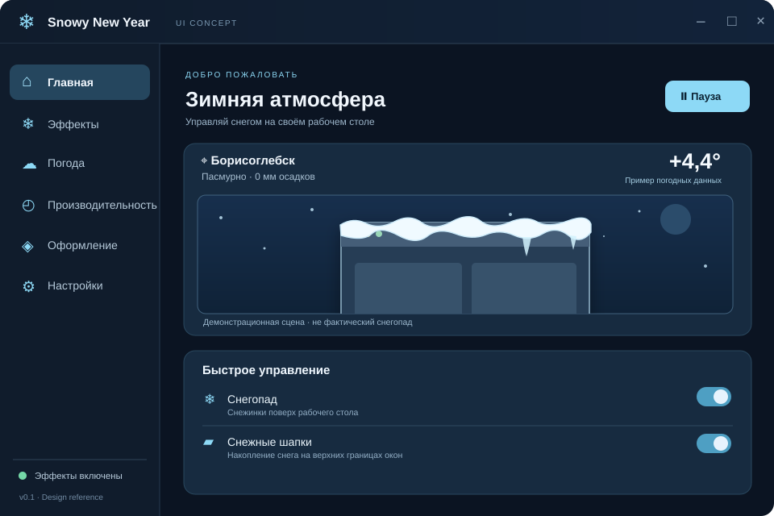

# Snowy New Year ❄️

Нативное приложение для Windows на Rust: снегопад поверх рабочего стола и снежные шапки на верхних границах окон.

Снег также накапливается вдоль нижней границы экрана. Чтобы стряхнуть шапку, зажмите заголовок окна и быстро потяните его влево, вправо и снова влево или наоборот. Оформление Frosted Glass использует холодные градиенты, полупрозрачные карточки и тёмный непрозрачный фон окна. Это надёжно работает без отдельного системного слоя размытия.

## Снежные шары и снеговики ⛄

В разделе «Эффекты» включите **«Лепить снежные шары мышью»** (включено по умолчанию):

1. Наведите курсор на видимый снег, который выступает **над** верхней границей обычного окна.
2. Удерживая **Shift + ЛКМ**, проведите по шапке. Шар собирает снег локально, оставляя за собой дорожку.
3. Не отпуская кнопки, перенесите шар ближе к нижней части рабочего стола и отпустите — шар опустится над панелью задач.
4. Скатайте **шар поменьше**, положите над первым — они соединятся. Добавьте третий, ещё меньший, чтобы собрать снеговика.
5. Уже готовый шар или снеговик можно перетащить сочетанием **Shift + ЛКМ**. Если перетаскивать основание, верхние шары переместятся вместе с ним.

Снеговик после отделения от шапки не зависит от окна-источника. Закрытие браузера удаляет снег на его окне, но **не уничтожает уже собранные шары**. Очищенные участки сугроба вновь заполняются по мере снегопада. Шары сохраняются только до завершения текущей сессии программы.

Технические ограничения, модель трёх уровней и тестовые сценарии: [docs/SNOWBALLS.md](docs/SNOWBALLS.md).

### Новые украшения и погодные эффекты (ветка разработки)

В ветке `feature/snowman-decoration-winter-effects` добавлены **три индивидуальных наряда для снеговика**. Когда снеговик готов, **Shift + ПКМ по голове** меняет классическую, праздничную и полярную одежду. В разделе «Эффекты» можно включить или отключить украшения.

Сосульки теперь постепенно растут на морозе и тают при потеплении, с них могут падать капли. Ветер влияет на форму нижних сугробов. Все новые эффекты имеют отдельные переключатели; при отсутствии достоверной температуры лёд не меняется по выдуманным значениям.

Подробности, ограничения и шаги тестирования: [docs/WINTER_EFFECTS.md](docs/WINTER_EFFECTS.md).

**Пока это проверяемые изменения в отдельной ветке, а не протестированный релиз.** Перед переносом в `main` нужно выполнить [Windows-скрипт проверки](scripts/check-windows.ps1) и проверить взаимодействие с мышью вручную.

> **Статус:** функциональность внесена в исходники, но пока не проверена сборкой и запуском на Windows. Проверка компиляции и поведения мыши остаётся обязательной перед релизом.


## Запуск

Соберите приложение на Windows с Rust 1.95 или новее:

```powershell
cargo build --release --locked
.\target\release\snowy-new-year.exe
```

Панель можно свернуть в трей кнопкой закрытия. Двойной щелчок по значку возвращает панель. Для остановки приложения выберите «Полностью выйти» в трее или настройках.

Реальная погода включена по умолчанию для Борисоглебска. WeatherAPI опрашивается при входе в погодный режим, раз в час и по кнопке «Обновить» на экране «Погода». Ручной режим работает офлайн. Настройки, кэш погоды и зашифрованный ключ находятся в `%LOCALAPPDATA%\Snowy New Year`.

Для настройки WeatherAPI в другом профиле Windows сохраните ключ через DPAPI в PowerShell 7:

```powershell
$snowyData = Join-Path $env:LOCALAPPDATA 'Snowy New Year'
New-Item -ItemType Directory -Force -Path $snowyData | Out-Null
$snowyKey = [Text.Encoding]::UTF8.GetBytes((Read-Host 'Ключ WeatherAPI' -MaskInput).Trim())
try {
    $snowyEncrypted = [Security.Cryptography.ProtectedData]::Protect(
        $snowyKey, $null, [Security.Cryptography.DataProtectionScope]::CurrentUser)
    [IO.File]::WriteAllBytes((Join-Path $snowyData 'weather-key.bin'), $snowyEncrypted)
} finally {
    [Array]::Clear($snowyKey, 0, $snowyKey.Length)
}
```

## Принятое решение №1 — снег принадлежит экземпляру окна

**Принято 11 ноября 2026 года.**

Каждое окно получает независимое состояние накопленного снега. Снег принадлежит **конкретному жизненному циклу окна**, а не браузеру, процессу, заголовку или приложению в целом.

| Событие | Поведение |
| --- | --- |
| Открылось новое окно | Снег начинается с нуля; состояние создаётся отдельно для этого окна. |
| Окно существовало до запуска Snowy New Year | Накопление начинается с нуля при первом обнаружении. |
| Окно перемещено | Снежная шапка следует за геометрией окна. |
| Окно изменило размер | Профиль снежной шапки адаптируется к новой ширине. |
| Окно свёрнуто | Отрисовка шапки прекращается, но накопление продолжает учитываться по времени. |
| Окно развёрнуто или занимает весь экран | Шапка скрывается до восстановления обычного размера окна. |
| Окно восстановлено | Показывается актуальная высота снега с учётом прошедшего времени и погоды. |
| Окно перекрыто другим | Невидимую шапку можно не рисовать, состояние окна сохраняется. |
| Окно закрыто/уничтожено | Состояние и ресурсы снега **немедленно удаляются**. |
| Тот же браузер открыт заново | Это **новый экземпляр окна**: снег снова накапливается с нуля. |
| Запущено полноэкранное приложение | Отрисовка ненужных эффектов приостанавливается; накопление для продолжающих существовать окон считается без кадровой симуляции. |

**Важно:** Win32 `HWND` не является вечным уникальным ID — Windows может использовать значение повторно. Для каждого обнаруженного жизненного цикла окна нужен собственный идентификатор/поколение, а уничтожение окна должно инвалидировать прежнее состояние. Нельзя восстановить снег по одному только имени процесса, классу окна или заголовку.

## Принятое решение №2 — визуализация отделена от накопления

- Снежинки — временные визуальные частицы, их не нужно «догонять» после паузы.
- Снежная шапка — устойчивое числовое состояние каждого живого окна: профиль высот вдоль его верхней границы, время последнего расчёта и погодные параметры.
- Если рисовать нечего, **0 кадров в секунду**; отключить графический цикл, а не рендерить прозрачные кадры.
- Если нет окон для снежных шапок, но пользователь включил **снегопад по рабочему столу**, частицы всё ещё нужно рисовать.
- При полноэкранной игре, блокировке или выключенном дисплее не тратить ресурсы на невидимую анимацию. Для нескольких мониторов желательно проверять видимость отдельно по каждому.
- Если в период паузы окно было уничтожено, его снег удаляется независимо от того, рисуем мы сейчас или нет.

### Отложенный расчёт вместо симуляции каждого кадра

При следующей необходимости отображения обновляем состояние по прошедшему времени:

```text
height_next = clamp(height_prev + accumulated_snow - melted_snow, 0, max_height)
accumulated_snow = ∫ accumulation_rate(weather, window_geometry, t) dt
melted_snow      = ∫ melting_rate(weather, t) dt
```

Реализация может интегрировать по редким временным интервалам погодных измерений; физику каждой снежинки в паузе считать не нужно. Для неоднородной снежной шапки применяем формулу по сегментам её профиля. После возвращения создаём только актуальные видимые частицы.

**Точность:** нельзя достоверно реконструировать погоду за несколько часов по одному последнему ответу API. Нужна история погодных срезов/прогноз или явно ограниченная оценка по последним известным данным. Погодный HTTP-запрос и обновление учётных данных можно делать редко и независимо от графического цикла.

## Технические ориентиры

- **Платформа:** Windows 10/11.
- **Основной язык:** Rust; нативные Win32-интеграции.
- **Отрисовка:** прозрачный оверлей с пропуском пользовательского ввода; аппаратное ускорение предпочтительно.
- **События окон:** отслеживать создание, уничтожение, перемещение, изменение размеров и видимости; периодическая сверка может страховать пропущенные события.
- **Экономия ресурсов:** при отсутствии видимого содержимого останавливать рендер и активную симуляцию; освобождать состояние закрытых окон.
- **Погода:** отдельный фоновый запрос к WeatherAPI. При ошибке показываются последние сохранённые данные. Оценка накопления по ним ограничена двумя часами после получения.
- **Ручной режим:** пользователь может включать снег независимо от фактических погодных условий.

## Утверждённый дизайн интерфейса

**Frosted Glass · Dark · Balanced** — тёмная зимняя палитра, ледяные акценты, компактная боковая навигация. Шесть экранов: **Главная, Эффекты, Погода, Производительность, Оформление, Настройки**.



- [Спецификация интерфейса, поведения и состояний](docs/UI_DESIGN.md)
- [Интерактивный макет всех шести экранов (HTML)](design/preview.html) — скачайте файл или клонируйте репозиторий и откройте локально в браузере.
- [Токены дизайн-системы (JSON)](design/tokens.json)
- [Векторный макет главного экрана (SVG)](design/main-screen.svg)

HTML-макет служит справочником по дизайну. **Нативная оболочка на `egui` приведена к макету**: тёмная непрозрачная поверхность, собственная верхняя панель с системными кнопками, боковая навигация ~190 px, шесть экранов, погодная карточка, снежный предпросмотр и быстрые переключатели. Приложение использует Win32 для оверлея, отслеживания окон и трея.

При закрытии панели настройки должны скрываться в трей (если он работает и функция включена), а снежный оверлей продолжает работу. На Windows поддерживаются перетаскивание за свободную область верхней панели и изменение размера за края окна.

> **Проверка релиза:** визуальные изменения записаны в исходники, но не подтверждены запуском на Windows в этой среде. Нужны `cargo fmt --check`, `cargo check --locked` и реальная проверка DPI/размера/прозрачности/трея на Windows 10 и 11.

Иконки приложения взяты из [Lucide](https://lucide.dev/icons/). Исходные SVG и [лицензия](assets/lucide/LICENSE) хранятся в `assets/lucide` и соответствуют [ревизии Lucide](https://github.com/lucide-icons/lucide/tree/03eae6069edfc373673bd05d723491f05ba936e3/icons).
