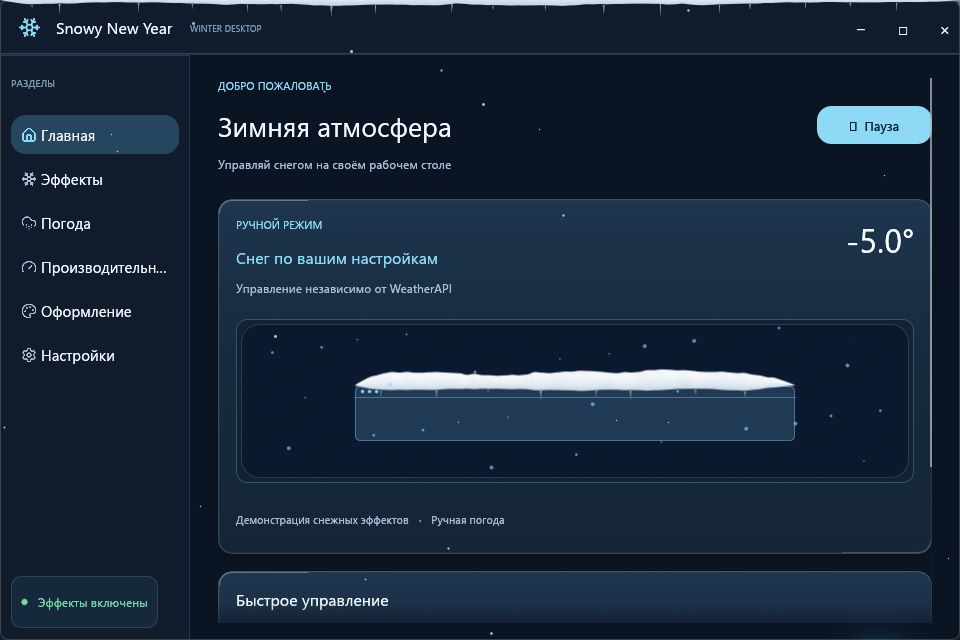
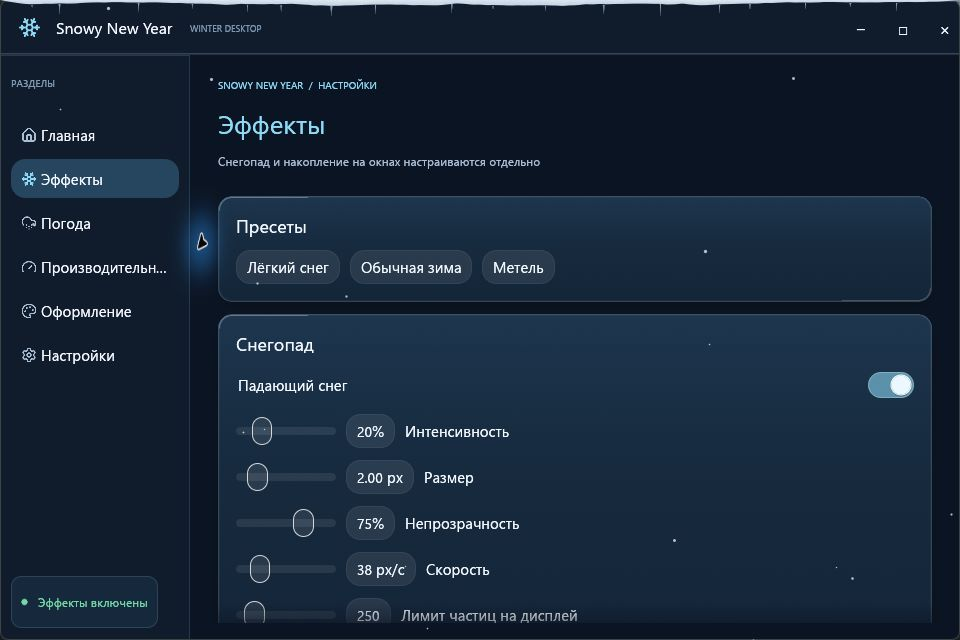

<div align="center">


# Snowy New Year

**Снегопад, сугробы и снеговики прямо на рабочем столе Windows.**

[Скачать для Windows x64](https://github.com/Deenfoool/snowy-New-Year/releases/download/v0.1.1/Snowy-New-Year-v0.1.1-windows-x64.zip) · [Все релизы](https://github.com/Deenfoool/snowy-New-Year/releases)

Windows 10 / 11 · Портативный ZIP · Интерфейс на русском

</div>



## Быстрый запуск

1. Скачайте и распакуйте ZIP, затем откройте **Snowy New Year.exe**.
2. Выберите **Погода → Ручной режим**, чтобы сразу настроить снег, ветер и температуру.
3. Оставьте обычное окно открытым, пока на нём накапливается снег. Толщину шапок и скорость накопления можно менять в разделе **Эффекты**.

По умолчанию закрытие панели сворачивает приложение в системный трей. Двойной щелчок по значку возвращает панель. Пункт **Полностью выйти** останавливает эффекты.

## Что умеет приложение

| Возможность | Как это работает |
| --- | --- |
| **Снегопад** | Снежинки летят поверх рабочего стола. Настраиваются интенсивность, размер, скорость и прозрачность. |
| **Шапки и снежная кромка** | Снег следует за окнами и накапливается вдоль нижней границы экрана. При разворачивании окна его шапка скрывается. |
| **Стряхивание снега** | Возьмите окно за заголовок и быстро потяните влево, вправо и снова влево или наоборот. |
| **Шары и снеговики** | Снег можно собрать с шапки в шар. За ним остаётся плавный след из примятого снега. |
| **Режимы погоды** | Ручной режим работает офлайн. WeatherAPI обновляет данные раз в час и по кнопке **Обновить**. |
| **Настройки оверлея** | Можно выбрать монитор, ограничить FPS и число снежинок, включить паузу для полноэкранных приложений. |



## Как слепить снеговика

1. Зажмите **Shift + ЛКМ** на видимой части шапки **над верхней границей окна**. Проведите вдоль окна, чтобы собрать снег.
2. Перенесите шар вниз и отпустите. Он опустится на нижнюю границу рабочей области.
3. Скатайте шар поменьше и отпустите над первым. Добавьте третий, ещё меньший, чтобы у снеговика появились лицо и пуговицы.

Готовые шары перетаскиваются тем же сочетанием. За основанием перемещается весь снеговик. Шары живут до выхода из приложения. [Подробнее о механике лепки](docs/SNOWBALLS.md)

## Реальная погода

Для режима **Реальная погода** нужен собственный ключ WeatherAPI. После сохранения ключа выберите город и нажмите **Обновить** в разделе **Погода**. По умолчанию выбран Борисоглебск.

<details>
<summary>Как сохранить ключ в Windows</summary>

Откройте PowerShell 7 и выполните команды. Windows зашифрует ключ для текущего профиля. Настройки и кэш погоды также хранятся в `%LOCALAPPDATA%\Snowy New Year`.

```powershell
$snowyData = Join-Path $env:LOCALAPPDATA 'Snowy New Year'
New-Item -ItemType Directory -Force -Path $snowyData | Out-Null
$snowyKey = [Text.Encoding]::UTF8.GetBytes((Read-Host 'Ключ WeatherAPI' -MaskInput).Trim())
try {
    $snowyEncrypted = [Security.Cryptography.ProtectedData]::Protect(
        $snowyKey, $null, [Security.Cryptography.DataProtectionScope]::CurrentUser)
    [IO.File]::WriteAllBytes((Join-Path $snowyData 'weather-key.bin'), $snowyEncrypted)
} finally {
    [Array]::Clear($snowyKey, 0, $snowyKey.Length)
}
```

</details>

## Сборка из исходников

Нужны Windows и Rust 1.95 или новее.

```powershell
cargo test --release --locked
cargo build --release --locked
.\target\release\snowy-new-year.exe
```

Панель Frosted Glass написана на Rust и `egui`. Оверлей, отслеживание окон и системный трей используют Win32. [Устройство оверлея](docs/ARCHITECTURE.md) · [Дизайн интерфейса](docs/UI_DESIGN.md) · [Лицензия иконок Lucide](assets/lucide/LICENSE)


---

## Island Lab — отдельный экспериментальный проект (только в этой ветке)

В каталоге [island-lab/](island-lab/) находится **независимый браузерный прототип** будущей панели рабочего стола в стиле Dynamic Island: свернутая капсула, аудиоплеер, LRC-текст, аудиореактивная волна вниз от нижней границы, погодная карточка, редактор скриншотов, заметки и визуальный модуль Snowy New Year.

**Запуск:** открыть [island-lab/index.html](island-lab/index.html) в Chrome/Edge. Смотри [документацию](island-lab/README.md) и [план нативного Windows-приложения](island-lab/ROADMAP.md).

Island Lab **не импортируется в Snowy New Year и не меняет его бинарник**. Прототип не имеет системного Windows Media Sessions, доступа к глобальному Print Screen или настоящего desktop-layer — для этого запланирован отдельный нативный хост.
